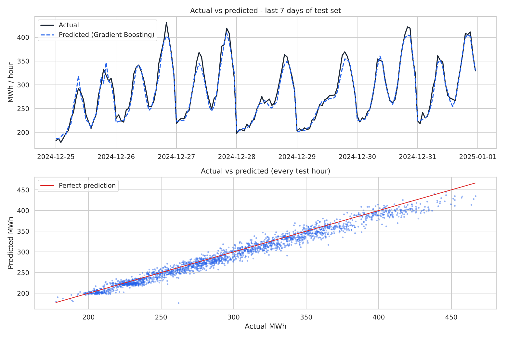
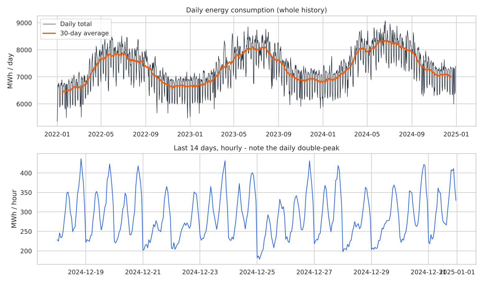
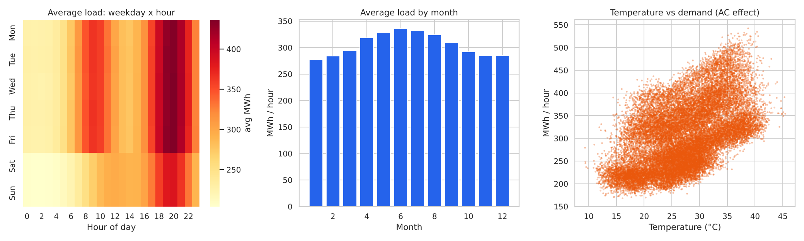
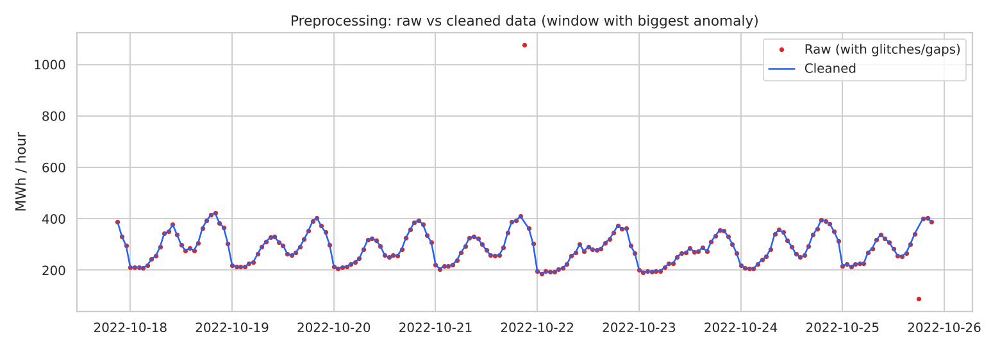
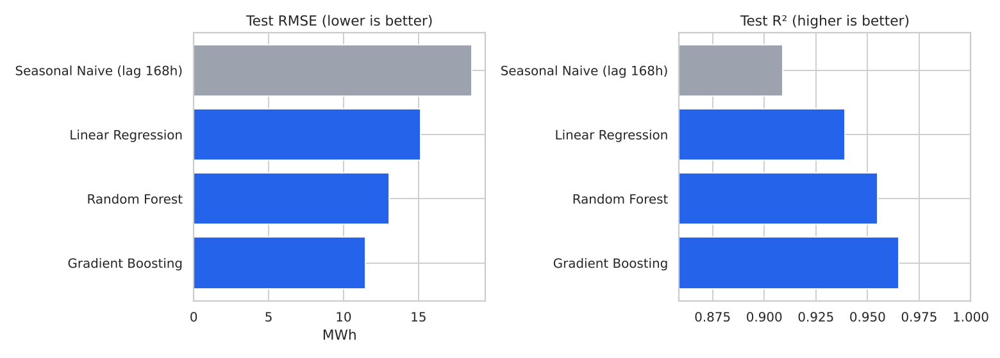
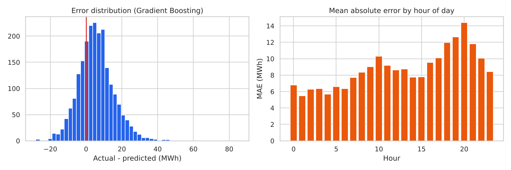
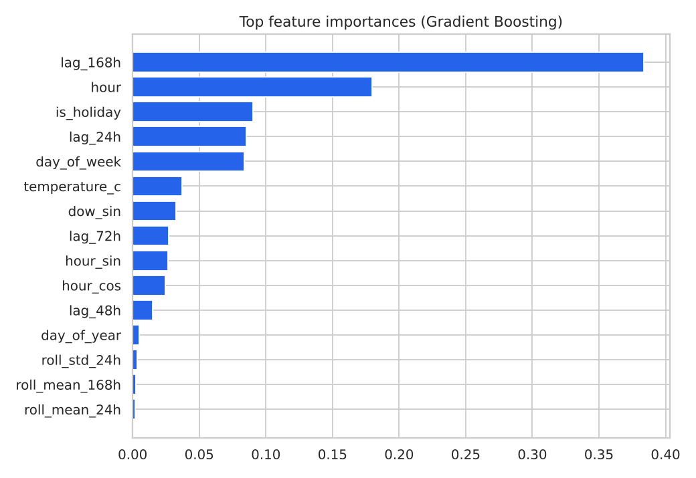
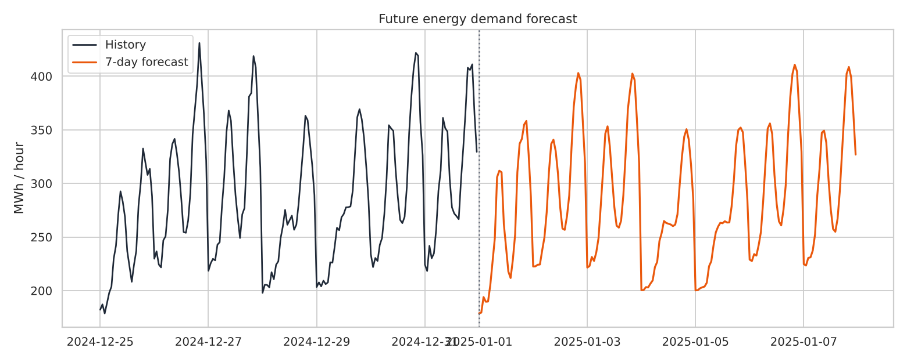
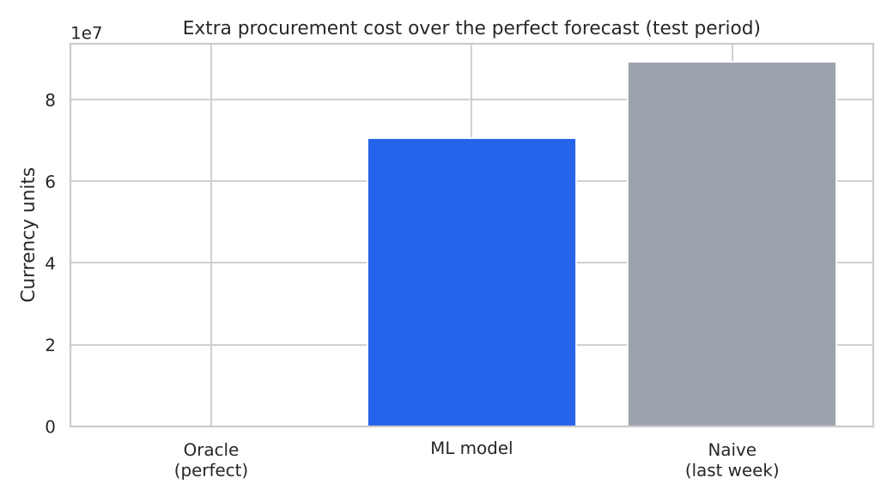

# ⚡ AI-Powered Energy Consumption Forecasting System

An end-to-end, industry-style machine-learning project that **simulates a smart-city district's hourly electricity demand**, cleans it, engineers features, trains and compares forecasting models, predicts the **next 7 days**, and translates forecast accuracy into a **business (cost) simulation**.

> Built for students: no real utility data, no GPU, no login/accounts, no database. Just Python + scikit-learn, one command to run.



## Table of contents
1. [Overview & problem statement](#1-overview--problem-statement)
2. [Industry relevance](#2-industry-relevance)
3. [Tech stack](#3-tech-stack)
4. [Dataset (virtual simulation)](#4-dataset-virtual-simulation)
5. [Architecture](#5-architecture)
6. [Installation](#6-installation)
7. [How to run](#7-how-to-run)
8. [How to test](#8-how-to-test)
9. [Results](#9-results)
10. [Screenshots](#10-screenshots)
11. [Project structure](#11-project-structure)
12. [Using your own dataset](#12-using-your-own-dataset)
13. [Limitations & future work](#13-limitations--future-work)
14. [Learning outcomes](#14-learning-outcomes)
15. [Troubleshooting](#15-troubleshooting)
16. [Web dashboard (no terminal needed)](#16-web-dashboard-no-terminal-needed)

---

## 1. Overview & problem statement
Electricity cannot be stored cheaply, so utilities, factories and data centers must **buy/generate the right amount of energy before it is used**. Buy too little → expensive spot-market purchases or blackouts. Buy too much → wasted energy resold at a loss.

**Problem:** given the history of hourly consumption and weather, predict future demand (next 24 hours to 7 days) accurately enough to cut cost and plan capacity.

**Solution here:** a reproducible pipeline — *simulate data → clean → feature engineering → train 3 ML models vs. a baseline → pick the best → forecast 7 days → estimate money saved*.

## 2. Industry relevance
| Sector | How forecasting is used |
|---|---|
| Electricity boards / utilities | Day-ahead power purchase, unit commitment, grid balancing |
| Smart cities | Street-lighting, EV-charging and building load planning, demand response |
| Manufacturing plants | Avoid peak-demand tariff penalties, schedule heavy machines off-peak |
| Data centers | Cooling + compute load planning, power contracts |
| Renewable companies | Match solar/wind output with demand, size battery storage |

## 3. Tech stack
Python 3.9+ · pandas · NumPy · scikit-learn (Linear Regression, Random Forest, HistGradientBoosting) · Matplotlib · Seaborn · joblib · unittest.
**No GPU required.** Full run ≈ 1 minute on a laptop.

## 4. Dataset (virtual simulation)
`src/data_generator.py` simulates **3 years (2022-2024) of hourly data** (26,304 rows) for a warm-climate city district:

| Column | Meaning |
|---|---|
| `timestamp` | hourly time stamp |
| `temperature_c` | outdoor temperature (seasonal + daily cycle + weather noise) |
| `humidity_pct` | relative humidity |
| `energy_mwh` | **target** – electricity demand (MWh per hour) |

Demand is built from real-world drivers: morning/evening double peak, weekend & public-holiday dips, **air-conditioning load rising with heat**, +3 %/year growth and random noise. The raw file is **deliberately dirty** (≈260 missing readings, ≈80 sensor spikes/dips, 25 missing hours, 5 duplicate rows) so preprocessing has real work to do. The generator is seeded → identical data every run.

## 5. Architecture
```
 ┌─────────────────┐   ┌──────────────┐   ┌───────────────────┐
 │ data_generator  │──▶│ preprocessing│──▶│ features           │
 │ (simulated or   │   │ dedupe, fill │   │ calendar, weather, │
 │  your own CSV)  │   │ gaps, outliers│  │ lags>=24h, rolling │
 └─────────────────┘   └──────────────┘   └─────────┬─────────┘
                                                    ▼
 ┌────────────────┐   ┌──────────────┐   ┌───────────────────┐
 │ visualization  │◀──│ simulation   │◀──│ models             │
 │ 9 PNG graphs   │   │ cost + peak  │   │ train/val/test,    │
 └────────────────┘   └──────▲───────┘   │ pick best, save    │
                             │           └─────────┬─────────┘
                             │                     ▼
                             └──────────── forecasting (recursive 7-day)
```
`src/pipeline.py` wires everything together; `main.py` is the CLI. More detail: [docs/03_architecture.md](docs/03_architecture.md).

## 6. Installation
Requirements: **Python 3.9 or newer** and `pip`. First **unzip** the download, then open a terminal **inside the folder that contains `main.py`** (check with `dir` on Windows / `ls` on Mac/Linux – you must see `main.py`, `requirements.txt`, `src`, `tests`).

**Windows – PowerShell (copy one line at a time; do NOT paste the `# comments`)**
```powershell
cd C:\Users\<you>\Desktop\AI-Energy-Forecasting
python -m venv .venv
.venv\Scripts\Activate.ps1
pip install -r requirements.txt
```
If activation is blocked: `Set-ExecutionPolicy -Scope Process Bypass` and run the activate line again. (Command Prompt: `.venv\Scripts\activate.bat`.)
Use `python`, not `python3`, on Windows, and never use `&&` or `source` in PowerShell 5.

**macOS / Linux**
```bash
cd AI-Energy-Forecasting
python3 -m venv .venv
source .venv/bin/activate
pip install -r requirements.txt
```
**Shortcut:** double-click `run_windows.bat` (Windows) or run `bash run_mac_linux.sh` (Mac/Linux) – it does setup, run and tests for you.

## 7. How to run
```bash
python main.py                 # full pipeline (~1 min)
python main.py --quick         # lighter models, ~30 s - great for a first try
python main.py --predict-only  # reuse saved model, just regenerate the 7-day forecast
python main.py --days 730 --seed 7   # different simulated dataset
python main.py --data my.csv   # your own dataset (see section 12)
python main.py --help
```
Where things appear:

| Output | Location |
|---|---|
| Raw + cleaned data | `data/energy_raw.csv`, `data/energy_clean.csv` |
| Trained model | `models/best_model.joblib` |
| Metrics (RMSE, MAE, MAPE, R²) | `outputs/metrics.csv`, `outputs/metrics.json` |
| Training log | `outputs/training_log.txt` |
| Cleaning report | `outputs/preprocessing_report.json` |
| 7-day forecast | `outputs/forecast_next_7_days.csv` |
| 7-day backtest | `outputs/backtest_7day.json` |
| Cost + peak simulation | `outputs/simulation_report.json` |
| Graphs | `images/*.png` |

## 8. How to test
```bash
python -m unittest discover -s tests -v     # no extra install needed (~25 s)
# or, if you have pytest:  pip install pytest && pytest -v
```
15 tests cover: reproducible data generation, cleaning (no NaNs / duplicates / gaps / spikes), **no-leakage lag features**, metric & cost maths, and a full end-to-end run in a temporary folder (outputs exist, best model beats the baseline with R² > 0.90, forecast has 168 valid hourly values, saved model reloads, model saves money vs. the naive planner).

**Manual check:** after `python main.py`, open `images/05_actual_vs_predicted.png` – the blue dashed prediction should follow the black actual line closely – and confirm `outputs/metrics.csv` lists Gradient Boosting R² ≈ 0.96.

## 9. Results
Chronological split: train 2022-01 → 2024-08, validation 60 days, **test = last 90 days (Oct–Dec 2024)**.

| Model | RMSE (MWh) | MAE | MAPE % | R² |
|---|---|---|---|---|
| Seasonal Naive (same hour last week) | 18.54 | 12.78 | 4.31 | 0.9088 |
| Linear Regression | 15.15 | 11.54 | 3.85 | 0.9391 |
| Random Forest | 13.04 | 9.82 | 3.23 | 0.9549 |
| **Gradient Boosting** (selected) | **11.45** | **8.75** | **2.88** | **0.9652** |

* Every model is a **day-ahead** forecast (lags ≥ 24 h only → no data leakage).
* **7-day recursive backtest** (forecast a whole week using only earlier data): MAPE 2.7–3.6 % over four windows.
* **Business simulation** (assumed prices in `src/config.py`): the ML planner removes **≈21 % of the extra cost caused by forecast errors** versus the naive planner (≈ 18.6 M currency units over the 90-day test, 0.57 % of total energy spend).
* Top drivers (feature importance): demand a week ago, hour of day, holiday flag, demand yesterday, day of week, temperature.

> Numbers come from simulated data, so they show the *method*, not a real utility's accuracy. Re-running with the same seed reproduces them (tiny differences between machines/library versions are normal).

## 10. Screenshots
| | |
|---|---|
|  |  |
|  |  |
|  |  |
|  |  |

## 11. Project structure
```
AI-Energy-Forecasting/
├── main.py                 # CLI entry point
├── app.py                  # launches the local web dashboard (UI)
├── webapp/                 # dashboard: Flask API (server.py) + single-page UI (static/index.html)
├── run_app_windows.bat / run_app_mac_linux.sh   # one-click dashboard launchers
├── requirements.txt
├── README.md
├── data/                   # energy_raw.csv (dirty), energy_clean.csv
├── src/
│   ├── config.py           # paths, constants, tariff assumptions
│   ├── data_generator.py   # virtual smart-city simulator
│   ├── preprocessing.py    # cleaning
│   ├── features.py         # feature engineering
│   ├── models.py           # train / evaluate / select / save
│   ├── forecasting.py      # recursive 7-day forecast + backtest
│   ├── simulation.py       # procurement-cost & peak-planning simulation
│   ├── visualization.py    # all graphs
│   └── pipeline.py         # orchestrates the steps
├── tests/test_pipeline.py  # unit + end-to-end tests
├── notebooks/              # exploration notebook (optional, see notebooks/README.md)
├── models/                 # saved model
├── outputs/                # metrics, logs, forecasts, reports
├── images/                 # PNG graphs
└── docs/                   # full project guide (explanations, plan, GitHub steps)
```

## 12. Using your own dataset
Provide a CSV with these columns (hourly rows; gaps/duplicates are fine, they get cleaned):
`timestamp, energy_mwh, temperature_c, humidity_pct`
Then `python main.py --data path/to/file.csv`. Need at least ~320 days of hourly history (1+ year recommended) so the validation + test windows and lag warm-up fit. Good public sources: Kaggle "Hourly Energy Consumption (PJM)", UCI "Household Power Consumption" – rename/resample columns to the format above.

## 13. Limitations & future work
* Future weather is a seasonal average; plug in a real weather-forecast API for better multi-day accuracy.
* Single aggregated load; extend to per-feeder / per-building forecasting.
* Try SARIMA / Prophet / LSTM, prediction intervals (quantile regression), hyper-parameter search, a Streamlit dashboard.

## 14. Learning outcomes
Time-series feature engineering (lags, rolling stats, cyclical encoding) · avoiding data leakage · chronological train/validation/test splitting · regression metrics (RMSE, MAE, MAPE, R²) · model comparison against a baseline · recursive multi-step forecasting · translating ML error into business value · writing tests for data/ML code · Git/GitHub project presentation.

## 16. Web dashboard (no terminal needed)
Prefer clicking over typing commands? The project now ships with a **local web app** (UI/UX) on top of the same pipeline – no login, no database, no internet, runs only on your own computer.

**Start it:** double-click `run_app_windows.bat` (Windows) · `bash run_app_mac_linux.sh` (Mac/Linux) · or manually `pip install -r requirements.txt` then `python app.py`. Your browser opens at <http://127.0.0.1:5000>.

| Page | What you can do |
|---|---|
| 📊 Dashboard | Headline KPIs, demand history + next-7-day forecast, daily/seasonal patterns |
| 🔮 Forecast | Interactive hourly forecast (24 h – 14 days), **heat-wave / cold-spell what-if slider**, peak-alert days, CSV download |
| 🤖 Models | Metrics table, RMSE bars, feature importance, 7-day backtest |
| 💰 Business impact | Cost of perfect vs ML vs naive planning and the money saved |
| 🧹 Data & quality | What cleaning fixed, raw vs clean rows |
| 🖼️ Graph gallery | All 9 graphs, click to enlarge |
| ⚙️ Run / Retrain | Train from the browser (simulated data or **upload your own CSV**), live log + progress bar |

All the command-line options above (`python main.py ...`) still work exactly as before. Details: [docs/08_web_app.md](docs/08_web_app.md).

## Full guide
Detailed explanations, tech-stack options, phase plan, simulation steps, GitHub upload strategy and the 7-day commit plan are in [`docs/`](docs/README.md).

## License
MIT – free to use for learning and portfolios.
